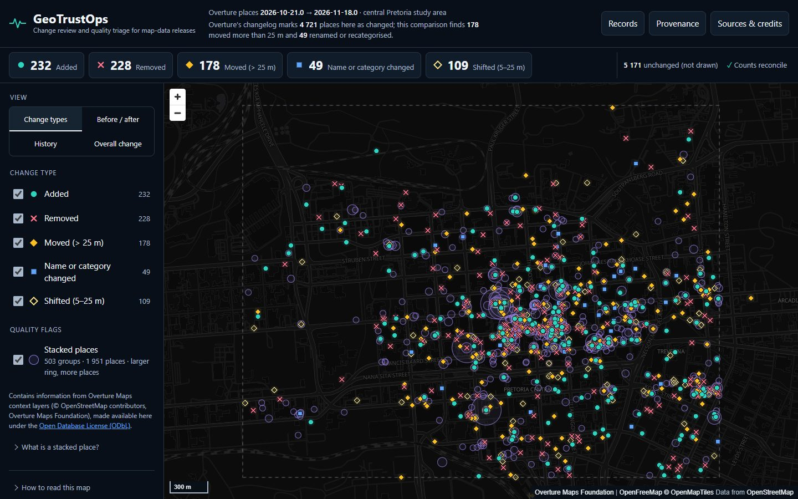
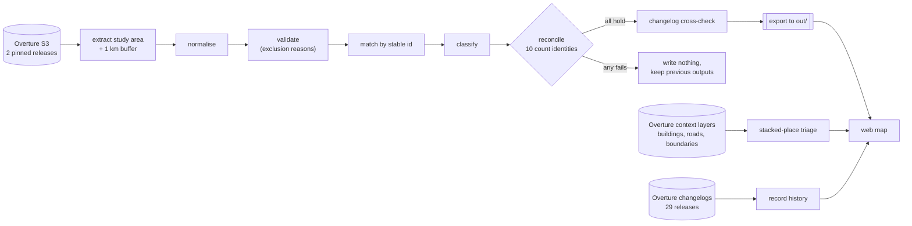
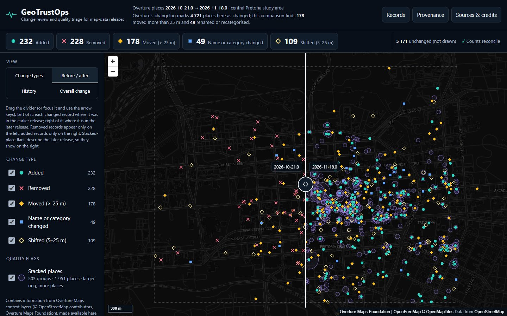

# GeoTrustOps

[](https://github.com/DanielJooste43/geotrustops/actions/workflows/tests.yml)

**Change review and quality triage for map-data releases.** GeoTrustOps helps someone evaluating
[Overture Maps](https://overturemaps.org/) places for an area answer two questions quickly: **what really changed
between two releases** (every record classified, the counts reconciled, the result cross-checked against Overture's
own changelog), and **which records show warning signs worth a manual look** (for example, many places stacked on
one point).

**Live map: <https://danieljooste43.github.io/geotrustops/>** · central Pretoria, Overture releases 2026-10-21.0 →
2026-11-18.0.

[](https://danieljooste43.github.io/geotrustops/)

> **Status: validated demo.** The pipeline, its verification and the web map are complete for one study area and two
> release pairs. It is a reproducible case study, not a hosted service: it does not fetch new releases on its own.

## Why

Overture publishes a changelog with every release. For central Pretoria (Oct → Nov 2026) it marks **79% of places
as `data_changed`**. Most of that is not a change anyone needs to review:

| | Places (study area) |
|---|---|
| Changelog says `data_changed` | 4,721 |
| **Material changes** found by GeoTrustOps (moved more than 25 m, or renamed / recategorised) | **227 (3.8%)** |
| Minor moves (5–25 m), reported separately | 109 |
| Address changes that were only a region-code migration (`GP` → ISO `ZA-GP`) | 4,450 |
| Phone changes that were only a format migration (local → international `+27…`) | 314 |

The changelog answers *"did any column change?"*; GeoTrustOps answers *"which changes matter, by how much, from
what to what?"*, and works for any two snapshots, including sources that publish no changelog. Added and removed
records (232 and 228) are reported separately: they agree one-to-one with the changelog, so the review effort lies in
telling real moves and renames apart from format noise.

## What it does



**1. What changed** (`geotrustops build`)
- **One change type per record**, first match wins: `excluded`, `added`, `removed`, `moved` (more than 25 m),
  `attribute_changed` (renamed or recategorised), `shifted` (5–25 m), `unchanged`.
- **Flags** for what else changed: kind of rename (case/spacing, punctuation, expanded/trimmed, different), category,
  operating status, contact fields, format-only migrations, crossing the study-area boundary.
- **Fails safe:** a run that excludes more than 5% of a release, or where any reconciliation identity fails, writes
  nothing and keeps the previous outputs. Same inputs → byte-identical outputs.

**2. Which records show warning signs**
- **Stacked places** ([`scripts/investigate/stack_causes.py`](scripts/investigate/stack_causes.py)): places within
  2 m of each other in the current release, each group with a likely cause from simple checks against Overture's
  buildings, roads and boundaries, and a manual-inspection flag. There is no severity score: the aim is to point a
  reviewer at the groups worth checking.
- **Record stability** (`geotrustops timeline`): each record's position in every release since July 2024, from
  Overture's changelogs. A record that keeps changing position is a warning sign of its own: Pretoria Zoo's record,
  for example, alternates between two positions 62.7 m apart in most releases since September 2025.

**The web map** shows both: change records by type, a before/after divider between the two releases, the record
history played back release by release, and the stacked-place flags. Every record opens a panel with its previous
and current values and positions. An extra "overall change" view draws every changed record as one glow, to show
where changes concentrate.

## Limitations

- **One study area** (central Pretoria, about 3.7 × 2.9 km) and **places only**; two release pairs are processed.
- **Matching is by Overture's stable id only.** A place that gets a new id is reported as one removal plus one
  addition; no fuzzy name or location matching is attempted.
- **The 25 m and 5 m thresholds are illustrative**, chosen for an urban street grid and documented as such; they are
  configuration, not truth.
- These are **map-record** changes: `added` ≠ a business opened, `removed` ≠ closed, `moved` ≠ the old position was
  wrong. Quality flags mean "worth a manual look", not "wrong".
- The record history depends on Overture's changelogs, which have gaps (no June 2025 changelog; some releases
  publish only unchanged records); the history view marks those releases instead of showing zeros.
- Reproducing the committed outputs after Overture removes a release from S3 needs the private archive described
  under [Reproducibility](#reproducibility).

## Quick start

Tested on Windows 10 with Python 3.12 (PowerShell). On Linux or macOS use `.venv/bin/` instead of `.venv\Scripts\`;
CI runs the same install and tests on Ubuntu.

```powershell
python -m venv .venv
.venv\Scripts\pip install -e ".[dev]"
.venv\Scripts\geotrustops fetch      # pinned extracts from Overture S3 -> data/raw (not committed), ~2 min
.venv\Scripts\geotrustops build      # -> out/changes.geojson, out/summary.json, out/qa_report.md
.venv\Scripts\geotrustops timeline --fetch   # changelog of every release -> out_timeline/timeline.json, ~10 min
.venv\Scripts\python -m pytest       # real-data tests are skipped if data/raw is absent
```

A second release pair: `geotrustops build --config config/pair_sep_oct.json`.
Inspect any record against the raw data: `python scripts/lookup_id.py <overture-id>`.

**Coordinates and units:** WGS 84 longitude/latitude (EPSG:4326) throughout; distances in metres by the haversine
formula on a 6,371 km sphere, accurate to well under a metre at these distances ([data contract §3](docs/data_contract.md)).

## Reproducibility

Overture keeps each release on S3 for at most 60 days, partly to honour data-protection removal requests, so the
pinned releases used here will disappear from the public bucket. Their extracts are therefore **not** republished:
they include business contact fields (phones, emails, websites, social links) that the outputs leave out.

- Every pinned extract is listed with its size and SHA-256 in [`data/archive.json`](data/archive.json).
- The files themselves are kept in a private archive. While S3 still serves a release, `geotrustops fetch` reads S3;
  when it no longer does, `fetch` restores the file from the archive (`GEOTRUSTOPS_ARCHIVE_REPO`,
  `GEOTRUSTOPS_ARCHIVE_TOKEN`) and accepts it only if size and SHA-256 match the committed manifest.
  `fetch --source s3` or `--source archive` forces one source.
- Restoring all five extracts from the archive and rebuilding both release pairs reproduces the committed `out/` and
  `out_pairs/` files byte for byte.
- **Access for verification is available on request** (open an issue). The archive is kept only to verify the
  published results: it is deleted 12 months after the v1.0 release, and any record is removed from it on request.

## Outputs

| File | For |
|---|---|
| `out/changes.geojson` | one point per changed place with before/after values, distance and flags (GeoJSON) |
| `out/summary.json` | counts, flags, reconciliation results, changelog cross-check, input hashes |
| `out/qa_report.md` | the same for a human reviewer: largest moves, renames by kind, exclusions, mismatches |
| `out_pairs/<prev>__<curr>/` | the same three files for the second release pair (Sep → Oct 2026) |
| `out_timeline/timeline.json` | record history: per-release counts and every added, removed or repositioned record in the study area across 29 releases since July 2024, from Overture's changelogs (data contract §12) |
| `out_triage/stack_causes.json` | quality triage: stacked places, each group with a likely cause and a manual-inspection flag (separate ODbL database; see [DATA_LICENSE.md](DATA_LICENSE.md)) |

## Web map

`web/` is a one-screen map of the exported files: change records by type (shape and colour), a before/after divider
between the two releases, a history view that plays the record history back release by release, quality flags for
stacked places, an overall-change view (one glow per changed record, with an optional smoothed density layer), a
record panel with previous and current values, positions and the record's position by release, a keyboard-accessible
records list, and a provenance panel with release ids, input checksums, reconciliation and the changelog cross-check.



It reads `out/changes.geojson`, `out/summary.json`, `out_triage/stack_causes.json` and `out_timeline/timeline.json`
only, and every number it shows comes from `summary.json` (or, for quality flags and history, from the triage and
timeline files): it never recomputes a classification or a count ([ADR 0004](docs/decisions/0004-engine-interface-separation.md)). A typed adapter validates the files against
the data contract and refuses to draw data that does not match.

```powershell
cd web
npm ci
npm run dev        # local map at the address it prints
npm test           # adapter and view tests, including checks against the committed exports
npm run licenses   # declared licence of every package; shipped code must be permissive
npm run build      # type check and production build into web/dist
```

The basemap is OpenFreeMap's Dark style (no key); if it cannot be loaded, the records are shown on a plain
background. Attribution stays visible on every screen size.

## How the results are verified

| Check | Independent because |
|---|---|
| Unit and pipeline tests ([`tests/test_pipeline.py`](tests/test_pipeline.py)) | include fault injection: deliberately broken classifications must fail reconciliation |
| Contract tests ([`tests/contract/`](tests/contract/)) | written from the specification alone, without reading the implementation |
| Golden records ([`tests/golden/`](tests/golden/)) | real places classified by hand from raw data before the pipeline's answers were seen (11/11 agree) |
| Overture changelog cross-check (`changelog_check` in [`out/summary.json`](out/summary.json)) | produced by Overture, not by this project (0 mismatches on both release pairs) |
| Weekly real-data run ([`.github/workflows/real-data.yml`](.github/workflows/real-data.yml)) | restores the hash-pinned inputs, runs the real-data tests and requires the rebuilt outputs to match the committed ones byte for byte |

Every pull request also runs the `lint`, `types` and `pytest` checks and receives an AI-assisted code review (Codex)
before merge, guided by the project's review rules in [`AGENTS.md`](AGENTS.md). Findings are verified before they are
acted on; review complements the checks above and does not replace them.

What each of these caught is in [`docs/engineering_review_log.md`](docs/engineering_review_log.md).

## Repository map

| Path | What it is |
|---|---|
| `src/geotrustops/` | the pipeline: `extract`, `pipeline` (SQL in DuckDB; each table states its row grain), `export`, `timeline`, `cli` |
| `tests/` | unit, pipeline, contract, golden-record and real-data tests |
| `config/` | study area, release pairs and timeline settings (no secrets) |
| `out/`, `out_pairs/`, `out_timeline/`, `out_triage/` | committed outputs, rebuilt byte for byte by the commands above |
| `web/` | the web map (TypeScript, MapLibre GL JS); reads the committed outputs only |
| `scripts/investigate/` | the stacked-place triage and the investigations behind it |
| `scripts/history/` | the first feasibility probes, kept as a record of how the project started (not part of the pipeline) |
| `runs/history.jsonl` | one line per distinct run (inputs, config, version, counts), behind the [calibration log](docs/calibration_log.md) |
| `data/archive.json` | sizes and SHA-256 of the pinned extracts (the extracts themselves are not committed) |
| `AGENTS.md` | contributor and code-review rules |

## Documentation

- [Methodology](docs/methodology.md): the logic stage by stage, with real examples
- [Data contract](docs/data_contract.md): the exact rules, tagged as generic, Overture-specific or South Africa-specific
- [Decision records](docs/decisions/): positioning, rule review, rule layers, engine/interface separation, naming
- [Engineering review log](docs/engineering_review_log.md): real defects and which check caught each
- [Source manifest](docs/source_manifest.md) · [Calibration log](docs/calibration_log.md) · [Investigation backlog](docs/investigation_backlog.md)

## Stack

Python 3.12 · DuckDB 1.4.2 (SQL, `spatial`, `httpfs`) · GeoParquet on S3 · pytest · ruff · mypy (strict) ·
TypeScript · MapLibre GL JS · GitHub Actions and Pages

## Third-party tools and services

Each was checked against its own licence before use. Only MapLibre GL JS is shipped to visitors of the web map,
with its licence.

| Component | Used for | Licence |
|---|---|---|
| DuckDB 1.4.2 and its `spatial` / `httpfs` extensions | SQL engine, geometry, S3 reads | MIT |
| Python 3.12 | runtime | PSF-2.0 |
| hatchling | build backend | MIT |
| pytest 9.2.0, pytest-cov 7.1.0 | tests, coverage | MIT |
| ruff 0.17.6 | lint and formatting | MIT |
| mypy 2.4.1 | static type checking | MIT (some bundled files PSF-2.0) |
| GitHub Actions: `actions/checkout` v7.0.1, `actions/setup-python` v7.1.0, `actions/setup-node` v7.1.0, `actions/upload-artifact` v7.0.2 | CI (pinned to commit SHAs) | MIT |
| GitHub Actions: `actions/configure-pages` v6.0.0, `actions/upload-pages-artifact` v5.0.0, `actions/deploy-pages` v5.0.1 | web map deployment (pinned to commit SHAs) | MIT |
| GitHub Pages | hosting of the web map | GitHub Terms of Service; data licences as above |
| Overture Maps data via AWS Open Data | source data | see [DATA_LICENSE.md](DATA_LICENSE.md) |
| Overture divisions, buildings and transportation themes | context layers for the quality-triage checks; layers not redistributed, derived results in `out_triage/` | ODbL 1.0; see [DATA_LICENSE.md](DATA_LICENSE.md) |
| MapLibre GL JS 6.17.0 | web map rendering (shipped) | BSD-3-Clause |
| TypeScript 7.0.2, Vite 8.3.8, Vitest 5.1.1, Node.js 26 LTS | web map build and tests (not shipped) | Apache-2.0 / MIT / MIT / MIT; Vite's CSS minifier `lightningcss` is MPL-2.0, used at build time only |
| OpenFreeMap (Dark style, hosted tiles) | basemap | free service, no key; style BSD-3-Clause code and CC BY 4.0 design; map data © OpenStreetMap contributors (ODbL), © OpenMapTiles |
| GitHub Releases (private repository) | archive of the pinned extracts | GitHub Terms of Service; data licences as above |

## Data and licence

Code: MIT ([LICENSE](LICENSE)). Data is **not** MIT: it is derived from Overture Maps Foundation releases and keeps
each source's licence (CDLA-Permissive-2.0, Apache-2.0, CC0-1.0), named in every output feature's `source_licences`.
Licence texts, the Foursquare notice and how to attribute: [DATA_LICENSE.md](DATA_LICENSE.md), [NOTICE](NOTICE), [LICENSES/](LICENSES/).
