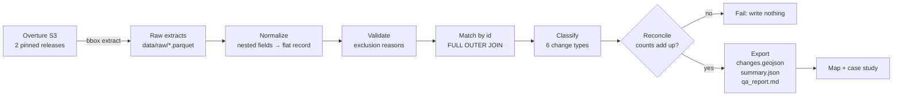
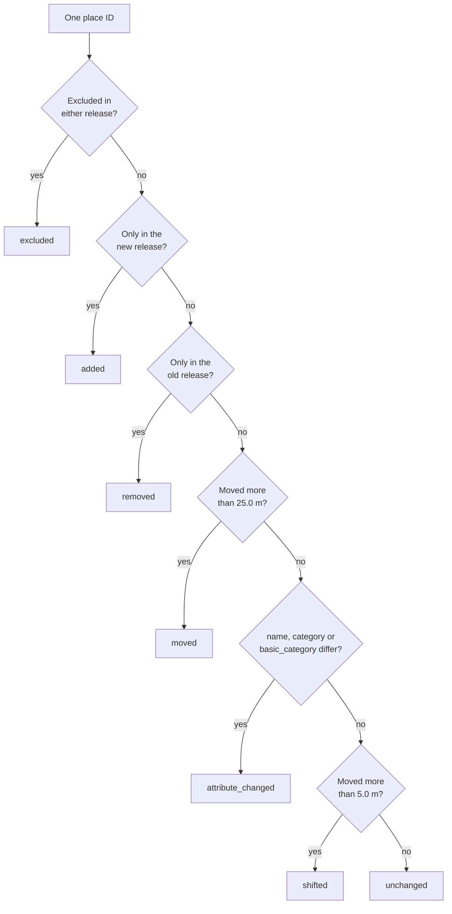

# Methodology — use case, logic, outputs and tools

Numbers marked *observed* come from real runs on 2026-11-23; everything else describes the design in
`docs/data_contract.md`. If the two ever disagree, the contract is authoritative.

---

## 1. The use case

### The problem
Map data is not a fixed product; it is re-released regularly. Overture Maps publishes a new
release roughly every month, each containing tens of millions of places (shops, schools,
churches, offices…). Anyone who **consumes** that data, such as a navigation company, a city GIS team,
a delivery business or a data QA team, faces the same question every release:

> **What changed since the last release, where did it change, and which changes deserve a human look?**

Without a tool, the options are bad: re-import everything blindly (and inherit any errors), or
inspect by eye (impossible at scale). A *release-to-release change inventory* is the standard
answer in map-data operations: it turns two big snapshots into a short, classified list of differences
that can be prioritised, sampled and reviewed.

### What GeoTrustOps does
For a small study area in central Pretoria, GeoTrustOps:
1. pins two specific, real Overture releases (`2026-10-21.0` → `2026-11-18.0`);
2. extracts only the places inside the study area;
3. checks the records are usable, and sets aside the ones that are not, **with a reason**;
4. matches each place across the two releases by its stable ID;
5. classifies every place into exactly one change type;
6. proves the counts add up;
7. exports small files that a map and a reviewer can use.

### What GeoTrustOps deliberately does NOT claim
| It reports… | It does **not** mean… |
|---|---|
| a record was **added** | a business opened |
| a record was **removed** | a business closed |
| a record **moved** | the old position was wrong, or the new one is right |
| an attribute **changed** | the new name/category is correct |

Changes in an open-data release can come from new source data, merging of duplicate records
(conflation), taxonomy updates, or a point crossing the study-area edge. GeoTrustOps describes **the
data**, not the ground. Saying this clearly is part of the professional skill being shown.

---

## 2. The pipeline at a glance

Each stage is described below with: **what happens**, **the logic**, **a real example**,
**the tool**, **what it demonstrates**, and **open questions**.

---

## 3. Stage by stage

### Stage 1 — Source and pin the data

**What happens.** We list the releases Overture has published, choose two, and download only the
places that fall inside our study-area box (bbox: west 28.168, south -25.758, east 28.205, north -25.732).

**The logic.**
- *Pin, don't assume.* Releases are named by date (`2026-11-18.0`). Writing the exact ID into
  config means the result can be reproduced next year, even after newer releases exist.
- *Read only what you need.* Each release's places theme is ~11 GB across 16 files *(observed)*.
  The files are GeoParquet, a columnar format that stores min/max statistics per block of rows. Because
  every record has a `bbox` column, DuckDB can skip blocks whose box doesn't overlap ours and download
  only the relevant parts. Result: **~690 KB per release, in 68 seconds for both** *(observed)*.
- *Record provenance.* Each extract gets a manifest: source URI, bbox, row count, SHA-256 hash, time.
  The hash proves later that the input didn't change between runs.
- *Zero rows is a failure, not "nothing changed".* An empty result almost always means a wrong path or box.

**Real result.** 5,733 places (Oct) and 5,738 places (Nov) *(observed)*.

**Tools.** Amazon S3 (public bucket, anonymous access) · GeoParquet · DuckDB `httpfs` extension · Python.

**What it demonstrates.** Working with cloud object storage and columnar formats; data sourcing
discipline (versioning, provenance, licence); efficient extraction by predicate pushdown rather than
"download everything". This mirrors source-evaluation and supplier-delivery work: knowing *which*
version you received and being able to prove it.

**Open questions.**
- Is the study area large enough to be interesting but small enough to inspect by hand?
- Should we compare consecutive releases, or skip one (Sep → Nov) to see more change?

---

### Stage 2 — Normalize: from nested source records to one flat record

**What happens.** Overture records are nested: `names` is a structure containing `primary`, plus
translations and rules; `taxonomy` holds `primary`, `hierarchy` and `alternates`; `geometry` is binary
(WKB). We turn each into a flat row with exactly the fields we compare or display.

**The logic** (full table in the contract §1).

| We keep | From | Why |
|---|---|---|
| `id` | `id` | the matching key (Overture's stable GERS ID) |
| `lon`, `lat` | decoded `geometry` | position, in WGS84 degrees |
| `name` | `names.primary` | the main display name; translations ignored for MVP |
| `category` | `taxonomy.primary` | detailed type, e.g. `auto_glass_service` |
| `basic_category` | `basic_category` | coarser type, e.g. `automotive_service` |
| `source_datasets`, `source_licences` | `sources[]` | attribution and licence per record |

**Fields are tiered by purpose (contract v0.3, ADR 0002 §3).** Overture's schema only *requires* `id` and
`geometry` (even the name is optional), so "required" tells us what is valid, not what matters:

| Tier | Fields | What a change does |
|---|---|---|
| Locate / Identify / Classify | geometry, name, category, basic_category | decides the change type |
| Lifecycle | operating_status, confidence | flags only (`status_changed`, `confidence_to_zero`); confidence is never classified on, because Overture says it is not comparable across providers |
| Enrich | addresses, phones, websites, emails, socials, brand | listed in `enrichment_changed`; never a change type |

**Format migrations are separated from content changes.** Region codes are normalised to ISO 3166-2
(`GP` → `ZA-GP`) and South African phone numbers to E.164 (`012…` → `+2712…`); a change that disappears after
normalisation is reported in `format_only_changed`. `version` is not compared (bookkeeping).

**Real example.** The feasibility probe checked the schema of both releases: 18 identical columns, no field added,
removed or retyped *(observed)*. There is **no** old-style `categories` column. The project brief
assumed one might exist, which is why schemas are inspected rather than assumed.

**Tools.** DuckDB SQL (struct access `names."primary"`, list functions over `sources`) · DuckDB `spatial`
extension (`ST_GeomFromWKB`, `ST_X`, `ST_Y`).

**What it demonstrates.** Schema mapping from a real, nested, evolving source into a controlled model:
the same task as aligning supplier data to a product specification. Also: deciding what *not* to
compare, and documenting why.

**Open questions.**
- Is `names.primary` the right name? A place could change only its English translation.
- Should `basic_category` count as a change on its own, or only `category`?

---

### Stage 3 — Validate: set records aside, with a reason

**What happens.** Before comparing, every row in each release is checked. A row that fails a check
is **excluded with a reason code**: never silently dropped.

**The logic** (first failing rule wins):

| Order | Reason | Rule |
|---|---|---|
| 1 | `missing_id` | no ID → cannot be matched |
| 2 | `duplicate_id` | same ID twice in one release → ambiguous; all copies excluded |
| 3 | `missing_geometry` | no position |
| 4 | `non_point_geometry` | not a point (places should be points) |
| 5 | `invalid_coordinates` | longitude/latitude outside the possible range |

**Study membership (boundary rule, contract v0.2).** We download a box ~1 km *larger* than the study
area (a buffer). A place is **in the study** if it is inside the study box in *at least one* release.
Why the buffer? A place just outside the box in October that moves inside by November would otherwise
not be in the October download at all, and would wrongly look **added**.

**Real example.** Every release passed rules 1–5 cleanly: 0 missing or duplicate IDs, 100% points,
0 missing coordinates *(observed)*. The boundary is where the logic was wrong: cross-checking against
Overture's own changelog (§3b) found **7 places** that v0.1 would have reported as 4 openings and 3
closures; in fact each had moved 44–404 m across the study-box edge *(observed 2026-11-23)*. With the
buffer, all 7 are matched and correctly classed as `moved` with a `crossed_aoi_boundary` flag.
Separately, a few points (e.g. *Affinity Mobile*, `17647df2…`) lie just outside the box in both
releases. Overture's stored `bbox` is rounded slightly outward, so the download filter lets them in; the
exact-point rule keeps them out of the study.

A run **fails completely** if more than 5% of a release is excluded: that pattern signals a broken
download, not a data feature.

**Tools.** DuckDB SQL (`CASE` rules, window `count(*) OVER (PARTITION BY id)` for duplicates) · Python
for the gate logic and clear error messages.

**What it demonstrates.** Data quality gates and exclusion auditing, the core of QA work: every record
is accounted for, and the reason for any exclusion can be reported to whoever supplies the data.

**Open questions.**
- Is 5% the right failure threshold for a small area?
- Should near-boundary points (within, say, 10 m) be included instead of excluded?

---

### Stage 4 — Match and classify: the heart of the logic

**What happens.** We line up the two releases by ID using a **FULL OUTER JOIN**: a join that keeps
IDs found in only one release as well as IDs found in both. Each ID then gets **exactly one** change type.

**The logic** (first match wins):

Every matched place also gets a **move band**: `stable` ≤ 5 m · `minor` 5–25 m · `material` 25–100 m ·
`major` > 100 m, so the map can show *how far*, whatever the change type.

Three technical rules hide inside this diagram:

**(a) Distance in metres, not degrees.** Longitude/latitude are angles. One degree of longitude is
~100 km here but shrinks towards the poles, so "difference in degrees" is meaningless as a distance. We use
the **haversine formula**, which gives the great-circle distance on a sphere of radius 6,371 km:
accurate to well under a metre at this scale.

**(b) NULL-safe comparison.** In SQL, `NULL = 'shop'` is not *false*; it is *unknown*, so a normal
`<>` comparison silently misses a category going from empty to filled. We use `IS DISTINCT FROM`,
which treats NULL as a value: `NULL IS DISTINCT FROM 'shop'` is true.

**(c) One label per record, plus flags.** A record can move *and* be renamed. The label shows the
highest-priority change (`moved`), and separate **flags** (`name_changed`, `category_changed`,
`name_change_kind`) record everything else, so nothing is lost.

**(d) Renames are classified by the kind of edit, not by quality.** `name_change_kind` is one of
`case_or_spacing`, `punctuation`, `expanded_or_trimmed` (one name contains the other), `different`, or
`added`/`removed`. Real renames include apparent degradations ("Topaz Disco CC" → "Topaz Disco PRETORIA,
Gauteng"), so the tool does not call any rename an improvement; that needs a reference source.

**Real examples (from the data, observed):**

| Record | Old → new | Distance | Type | Why |
|---|---|---|---|---|
| Major Service Shop | same name/category | 29.2 m | **moved** | just over 25 m |
| In City Ink Tattoos… | same name/category | 22.5 m | **shifted** (band `minor`) | between 5 and 25 m, nothing else differs |
| PG Glass | → "PG Glass Pretoria CBD"; `windows_installation` → `auto_glass_service` | ~15 m | **attribute_changed** (band `minor`) | attribute change outranks a minor move |
| Pretoria School *for* → *For* … | capitalisation only | 24.0 m | **attribute_changed**, kind `case_or_spacing` | text differs; the kind records what sort of edit |
| Shoprite | category NULL → `grocery_store` | 11.3 m | **attribute_changed** | caught only because the comparison is NULL-safe |
| Mr Price Cellular Pta → Mr Price | renamed | 39.5 m | **moved** + `name_changed` | move outranks rename; flag keeps the rename |

**Why 5 m and 25 m, and not per category?** 5 m approximates consumer-GPS error, so smaller moves aren't
reportable. 25 m is an *illustrative* "material" threshold; it is **not** an Overture accuracy specification.
Per-category thresholds were considered and rejected (ADR 0002 §1): no POI accuracy standard exists, Overture
does not say what the point represents (entrance? centroid?), and each category has too few moves to calibrate.
All thresholds are in config and recorded in `docs/calibration_log.md`.

**Tools.** DuckDB SQL: `FULL OUTER JOIN`, `IS DISTINCT FROM`, `CASE` priority logic, trigonometric
functions for haversine. Python orchestrates.

**What it demonstrates.** Spatial reasoning (units, projections, distance) combined with SQL correctness
(join semantics, three-valued NULL logic, deterministic classification): the exact pitfalls that produce
wrong numbers in real pipelines. Reconciling records across versions is the same skill as cadastral,
address or supplier-release reconciliation.

**Open questions.**
- Should the threshold depend on category (a mall vs a kiosk)?
- Should some rename kinds (e.g. `case_or_spacing`) be hidden on the map by default?
- Should a large move with a rename get its own type (`moved_and_renamed`)?

---

### Stage 4b — "Doesn't Overture already publish a changelog?" Yes, and we use it as a check

Overture publishes a **GERS changelog** with every release: for each place ID, one of `added`,
`removed`, `data_changed`, `unchanged`, plus the list of columns that changed. So why build GeoTrustOps?

**What the changelog says for our study area** (2026-11-18.0 vs 2026-10-21.0; GeoTrustOps column from the current outputs):

| Changelog type | Places | What GeoTrustOps says about the same places |
|---|---|---|
| `data_changed` | 4,721 (**~79%** of the area) | only 227 are material: 178 moved > 25 m, 49 renamed or recategorised |
| ↳ columns: `addresses` only | 3,493 | not compared by GeoTrustOps (see open question below) |
| ↳ includes `geometry` | 340+ | only 178 moved more than 25 m; the rest moved less |
| `added` / `removed` | 232 / 228 | agree 1:1 (after the boundary fix) |
| `unchanged` | 786 | agree: all unchanged |

**Positioning: the changelog answers "did any column change?"; GeoTrustOps answers "which changes matter,
by how much, from what to what?"** Specifically, the changelog has no old/new values, no distance
(a 0.5 m nudge and a 400 m jump both say `geometry`), no threshold, no rename kinds, no format-vs-content split, no QA
exclusions and no study-area boundary logic. And most map-data sources (supplier deliveries, municipal
exports, internal products) publish **no changelog at all**; GeoTrustOps works on any two snapshots.

**How the changelog is used: as an independent oracle** (contract §9). It is produced by Overture,
not by us, so it is a free external check: every GeoTrustOps `added` must be a changelog `added`, every
`moved` must list `geometry`, and so on. It has already earned its place: it exposed the boundary bug in
contract v0.1 (Stage 3).

**Answered (v0.3):** the address changes were mostly a **format migration**. In Oct→Nov, 4,450 places in the
study changed addresses only by region code (`GP` → `ZA-GP`) and 314 only by phone format (local → E.164);
Sep→Oct had 0 and 6. After normalisation, real address changes are similar in both pairs (259 vs 177).
The one enrichment field that genuinely spiked in November is **websites** (437 vs 52), mostly removals:
of 625 website changes in the extraction, 552 were complete removals, 458 of them `http://`-only links
(observed; Overture's reason is not documented).

**Tools / skill shown.** Using an authoritative external dataset to *validate* a pipeline rather than trusting it, and stating precisely what the tool adds over what already exists.

---

### Stage 5 — Reconcile: prove the numbers add up

**What happens.** Before anything is written, the pipeline checks that its counts are internally
consistent. If any check fails, the run stops and **writes nothing**.

**The logic** (contract §4), in plain words:
1. Every input row is either valid or excluded: none vanish.
2. The six change types add up to the total number of distinct IDs.
3. Every valid new-release ID is either *added* or *matched*; every valid old-release ID is either
   *removed* or *matched*.

**Real check** (feasibility probe, before exclusions): 5,502 matched + 236 added = 5,738 ✔ ;
5,502 matched + 231 removed = 5,733 ✔ *(observed)*.

**Tools.** SQL aggregates + Python assertions · pytest.

**What it demonstrates.** The difference between "the script ran" and "the result is right". Reconciliation
is how data teams catch silent record loss.

---

### Stage 6 — Export: what the outputs describe

| File | What it describes | Who uses it |
|---|---|---|
| `out/changes.geojson` | One map point per **changed** place (added, removed, moved, attribute_changed, shifted) with old and new values, both positions, distance and flags. Removed places are drawn at their **old** position; others at the **new** one. | The web map; a GIS analyst in QGIS |
| `out/summary.json` | Release IDs, bbox, threshold, input counts, exclusions by reason, counts per change type and flag, reconciliation results, input file hashes | The map's metric cards; automated checks |
| `out/qa_report.md` | The same numbers in readable form, the 10 largest moves, every excluded row | A human reviewer, the case study |

**How to read them.** The outputs are a **review queue**, not a verdict. A sensible reading: "178 places
moved more than 25 m between releases, mostly 25–100 m, with 21 over 300 m. The largest moves are
where a reviewer should start." Not: "178 businesses relocated."

**Design choices.**
- *Deterministic:* same inputs → byte-identical files (sorted rows, rounded coordinates, no timestamps).
  A test proves it by comparing file hashes across two runs.
- *Atomic:* outputs are written to a temporary folder and only swapped in once every check passes,
  so a failed run never overwrites a good result.
- *Small:* only changed places are exported (~700 of ~5,900), keeping the map fast.

**Tools.** DuckDB → Python → GeoJSON (RFC 7946, the web-map standard) · JSON · Markdown.

**What it demonstrates.** Designing outputs for their consumers (machine vs human), reproducibility,
and safe failure behaviour: production habits, applied at a small scale.

---

### Stage 7 — Verify: why the results can be trusted

**What happens.** Four checks that do not depend on each other:

| Check | How it is independent | Catches |
|---|---|---|
| Unit and pipeline tests | written alongside the implementation | regressions in intended behaviour |
| Contract tests (`tests/contract/`) | written from `docs/data_contract.md` alone, without reading the implementation | misreadings of the specification |
| Golden records (`tests/golden/`) | 11 real places classified by hand from raw data, before the pipeline's answers were seen | errors shared by code and its tests |
| Overture changelog oracle (contract §9) | produced by Overture, not by this project | logic errors invisible to internal checks (it exposed the boundary bug) |

Every change is reviewed before merge, and reconciliation identities are tested by deliberately injecting faults.

**Tools.** pytest · fault injection (monkeypatched SQL) · Git feature branches and pull requests · GitHub Actions.

**What it demonstrates.** Verification beyond "the tests pass". The earlier, unpublished prototype this project
started from documented "13 tests pass"; re-running them gave 6 failures on two DuckDB versions *(observed)*. Here, each
class of check catches a different class of error; `docs/engineering_review_log.md` lists the real defects each
one found. The golden-record step is the same idea as a QA sampling plan: a manually verified sample the
automated process must agree with.

---

### Stage 8 — Present (planned) and publish (planned)

**What will happen.** A one-page interactive map: colour-coded change types, filters, metric cards from
`summary.json`, click a point to see before/after values, lines for moves, and a visible limitations
note. Then a README, case study, CI and GitHub Pages hosting.

**Tools (planned, not yet built).** React + TypeScript + Vite · a map library (to be chosen, with
correct attribution) · GitHub Actions · GitHub Pages.

**What it will demonstrate.** Turning a data product into something a non-technical reviewer can use
in two minutes, and shipping it with documentation and automated checks.

---

## 4. Real numbers (pipeline, contract v0.3 rules, observed 2026-11-23)

| Type | Feasibility probe | v0.2 | **v0.3 Oct→Nov** | **v0.3 Sep.1→Oct** | Note |
|---|---|---|---|---|---|
| added | 236 | 232 | **232** | **289** | probe→v0.2: 4 were boundary crossers |
| removed | 231 | 228 | **228** | **0** | probe→v0.2: 3 were boundary crossers |
| moved (> 25 m) | 171 | 178 | **178** | **111** | +7 crossers matched in v0.2 |
| attribute_changed | 49 | 49 | **49** | **72** | |
| shifted (5–25 m) | (n/a) | (n/a) | **109** | **74** | new in v0.3, previously hidden in unchanged |
| unchanged | 5,282 | 5,280 | **5,171** | **5,187** | |
| excluded | (n/a) | 0 | **0** | **0** | |
| **ids in study** | 5,969 | 5,967 | **5,967** | **5,733** | |

Both pairs: all reconciliation identities hold and the changelog cross-check has **0 mismatches** across 5 rules
(Sep.1→Oct's 289 added / 0 removed match its changelog exactly).
**Rejected hypothesis:** large moves are *not* snapping to a shared point (no ~1 m location received more
than 2 moved records). This is recorded because negative results are evidence too.

---

## 5. Tools summary

| Tool | Where used | Skill shown | Key concept |
|---|---|---|---|
| Overture Maps / S3 / GeoParquet | Stage 1 | open-data sourcing, cloud storage, columnar formats | why release IDs are pinned; what predicate pushdown is |
| DuckDB SQL | Stages 1–6 | analytical SQL, joins, NULL logic | FULL OUTER JOIN vs INNER; `IS DISTINCT FROM`; the CASE priority |
| DuckDB spatial | Stage 2 | geometry decoding | what WKB is; why lon/lat are degrees |
| Haversine | Stage 4 | geodesy basics | why degrees ≠ metres; why 25 m is illustrative |
| Python | all stages | packaging, orchestration, error handling | how a failed check stops the run |
| pytest + golden records | Stage 7 | testing, QA sampling | independent checks vs self-checks |
| Git / GitHub | Stage 7–8 | version control, review workflow | branch → review → merge |
| React/TS/Vite + map library | Stage 8 | web mapping | (planned) |

---

## 6. Open design questions

Rule changes were reviewed against evidence in `docs/decisions/0002-rule-review.md`. Still open (each is a config or
contract change, followed by re-checking the golden records):

1. Move threshold (25 m), possibly per category, once a positional reference exists.
2. Which rename kinds are shown on the map by default.
3. Whether further fields are compared (e.g. `confidence`, given it is not comparable across providers).
4. Buffer size, if a release shows movers beyond ~1 km (the changelog oracle would detect them).
5. The exclusion failure threshold (5%), once enough runs exist in the calibration log.
6. Study-area size and release pairs.
